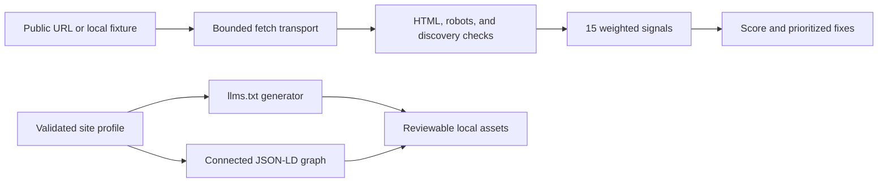

# AI Search Visibility Audit

A Python CLI that scores a website's technical readiness for AI answer engines, prioritizes fixes, and generates `llms.txt` plus connected JSON-LD.

## Why I built it

I wanted to separate AI search fundamentals from vague advice about getting cited by ChatGPT, Perplexity, or Google AI Overviews. A site can publish good content and still hide it behind missing crawl controls, weak metadata, or absent structured data. This tool turns those checks into an inspectable score and produces the two remediation assets that are easiest to automate safely.

## How it works



- The auditor checks 15 signals worth 100 points: `llms.txt`, four schema categories, answerable page content, core metadata, sitemap and robots discovery, author information, HTTPS, and canonicalization.
- Every failed signal includes observed evidence, a point value, and a specific remediation. Fixes are sorted by score impact.
- Generation is deterministic. A JSON profile becomes `llms.txt` and one JSON-LD `@graph` connecting the organization, website, services, audience, and visible FAQs.
- The demo uses a fictional website adapter backed by local HTML and text files. It makes no DNS or HTTP requests.

## Design decisions and guardrails

- The score measures technical readiness, not rankings or guaranteed citations. It does not pretend to test what a closed model has indexed.
- Live requests allow only HTTP and HTTPS on ports 80 and 443. Localhost, private, loopback, link-local, reserved, multicast, and unresolved destinations are rejected to reduce SSRF risk.
- Redirect destinations receive the same network validation as the original URL. Responses are capped at 2 MB and requests have a fixed timeout.
- The demo fetcher maps one `.example` origin to one fixture directory and rejects cross-origin paths and directory traversal.
- `robots.txt` is parsed with crawler rules. A restriction such as `Disallow: /private/` is not mistaken for a site-wide block.
- JSON-LD type extraction handles nested `@graph` nodes and `@type` arrays.
- The combined `run` command refuses to generate assets when the audited URL differs from the profile URL. This prevents a report for one site from being paired with another site's markup.
- Profile pages must stay on the configured origin. JSON-LD escapes HTML closing sequences so profile text cannot end the script block early.
- The tool writes local files only. It contains no deployment code, credentials, analytics, or telemetry.

## Quick start

Run the complete offline demo first. It audits the fictional Northwind Dental fixture, prints its score and prioritized fixes, then writes both generated assets:

```bash
python3 -m ai_search_visibility_audit demo --output-dir output/demo
```

No API keys, environment variables, package installation, or network connection are required for the demo.

For a real public site, copy the example profile and replace every fictional value:

```bash
cp config.example.json config.json
python3 -m ai_search_visibility_audit run https://your-site.example \
  --config config.json \
  --output-dir output/your-site
```

The `run` command performs outbound GET requests to the supplied public origin. It does not need credentials. Review the generated files before publishing `llms.txt` at the site root or placing `schema.html` in the matching page's `<head>`.

Audit without generating files:

```bash
python3 -m ai_search_visibility_audit audit https://your-site.example
python3 -m ai_search_visibility_audit audit https://your-site.example --json
```

Generate from a profile without making a network request:

```bash
python3 -m ai_search_visibility_audit generate \
  --config config.json \
  --output-dir output/your-site
```

### Scoring model

| Signal | Points |
|---|---:|
| `llms.txt` | 12 |
| Organization schema | 10 |
| FAQPage schema | 10 |
| Service or Product schema | 8 |
| Visible FAQ content | 8 |
| Direct answer paragraph | 7 |
| Meta description | 6 |
| Article or BlogPosting schema | 5 |
| Open Graph title and description | 5 |
| Exactly one H1 | 5 |
| XML sitemap | 5 |
| About or team page | 5 |
| HTTPS | 5 |
| Canonical URL | 5 |
| `robots.txt` allows major AI crawlers | 4 |

Grades are A at 85 or above, B at 70, C at 55, D at 40, and F below 40.

## Example output

Abbreviated output from the offline demo:

```text
Offline demo: all site responses came from packaged fixture files
AI Search Visibility Audit
Site: https://northwind-dental.example
Score: 37/100 (Grade F)
Signals: 7/15 passed

Prioritized fixes:
  1. [12 pts] Publish the generated llms.txt at /llms.txt.
     Evidence: No /llms.txt response was found
  2. [10 pts] Add FAQPage JSON-LD that matches visible questions and answers.
     Evidence: No FAQPage entity was found
  3. [10 pts] Add Organization JSON-LD with a stable @id.
     Evidence: No organization entity was found

Generated assets:
  output/demo/llms.txt
  output/demo/schema.html
```

The fixture intentionally has useful basics and important gaps. Its generated schema addresses Organization, FAQPage, and Service signals, while the fix list still calls out work that requires an editorial or site-level decision.

## Tests

Install the major-version-pinned test dependency and run the offline suite:

```bash
python3 -m pip install -r requirements.txt
python3 -m pytest
```

## Tech

- Python 3.10 or newer
- Python standard library for HTTP, DNS checks, HTML parsing, robots parsing, JSON, and file generation
- pytest for the offline test suite
- No runtime packages or external APIs

## License

MIT. Copyright (c) 2026 Christian Terrone.
